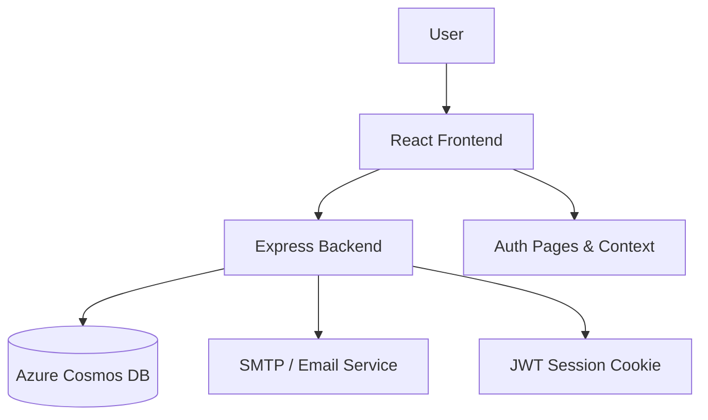
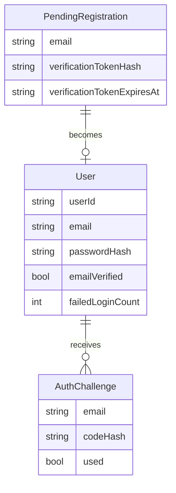
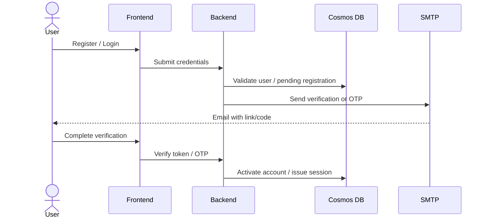

# Overload Documentation

- Project name: Overload
- Last generated: 2026-07-15T09:22:53.315Z
- Last updated: 2026-07-15T09:22:53.315Z
- Documentation version: 1.0.0

## Project Overview

Overload is a full-stack authentication-focused web app with a React frontend and an Express backend backed by Azure Cosmos DB. The current implementation provides account registration, email verification, OTP-based sign-in, and a protected dashboard shell.

## System Architecture

### Architecture Notes
- The frontend is a React + TypeScript SPA that routes users through login, registration, verification, OTP, and dashboard screens.
- The backend exposes auth routes and stores user data in Azure Cosmos DB while issuing JWT-backed session cookies.
- Email delivery uses nodemailer with a development fallback to JSON transport when SMTP is not configured.

## Technology Stack

- Node.js / TypeScript
- Express.js
- React 19 + TypeScript
- React Router
- Tailwind CSS
- Azure Cosmos DB SDK
- Argon2 password hashing
- Nodemailer and JWT

### Backend dependencies
- @azure/cosmos, @types/cookie-parser, argon2, cookie-parser, cors, dotenv, express, helmet, jsonwebtoken, nodemailer, uuid

### Frontend dependencies
- @tanstack/react-query, @testing-library/dom, @testing-library/jest-dom, @testing-library/react, @testing-library/user-event, @types/jest, @types/node, @types/react, @types/react-dom, axios, react, react-dom, react-router, react-router-dom, react-scripts, typescript, uuid, web-vitals

## Folder and File Structure

- .env- .gitignore- .vscode/
  - settings.json- README.md- backend/
  - package-lock.json  - package.json  - src/
    - config/
      - cosmos.ts    - index.ts    - middleware/
      - auth.middleware.ts    - models/
      - user.model.ts    - routes/
      - auth.routes.ts    - services/
      - auth.service.ts    - utils/
      - hash.ts  - tsconfig.json- frontend/
  - .env  - .gitignore  - .vscode/
    - settings.json  - README.md  - package-lock.json  - package.json  - postcss.config.js  - public/
    - favicon.ico    - index.html    - logo192.png    - logo512.png    - manifest.json    - robots.txt  - src/
    - App.css    - App.test.tsx    - App.tsx    - api/
      - auth.ts      - client.ts    - components/
      - PrivateRoute.tsx    - context/
      - AuthContext.tsx    - index.css    - index.tsx    - logo.svg    - pages/
      - Dashboard.tsx      - Login.tsx      - Otp.tsx      - Register.tsx      - Verify.tsx    - react-app-env.d.ts    - reportWebVitals.ts    - setupTests.ts    - styles.d.ts  - tailwind.config.js  - tsconfig.json- package-lock.json- package.json- scripts/
  - docs-watch.js  - generate-docs.js

## Database Configuration and Schema

The backend uses Azure Cosmos DB via the Cosmos client in [backend/src/config/cosmos.ts](backend/src/config/cosmos.ts). The configured database is expected to be available through the emulator or a reachable Azure account.

### Containers
- Users: stores user account records, email verification flags, and lockout state.
- PendingRegistrations: stores short-lived unverified registration data.
- AuthChallenges: stores one-time password challenge records.
- WorkoutSplits and SessionLogs: reserved for future workout-domain data.

### Data models
- [backend/src/models/user.model.ts](backend/src/models/user.model.ts) defines the 'User' and 'PendingRegistration' shapes.
- 'User' includes fields such as 'userId', 'email', 'passwordHash', 'emailVerified', 'failedLoginCount', and optional lockout metadata.
- 'PendingRegistration' includes the email, name, phone number, password hash, verification token hash, and expiry timestamps.

## Authentication and Authorization Flow

### Current flow
1. The user registers with first and last name, email, phone number, and password.
2. A pending registration is created and a verification email is sent.
3. The verification link activates the account and writes the verified user record to Cosmos DB.
4. The user logs in with email and password, then completes OTP verification.
5. A JWT is issued in an HTTP-only cookie for protected routes.

### Security controls implemented
- Argon2id password hashing
- Email verification before activation
- OTP expiry and resend limits
- Account lockout after repeated failed login attempts
- HTTP-only and same-site session cookies

## API Endpoints and Routes

| Method | Route | Purpose |
| --- | --- | --- |
| GET | /api/health | Health check |
| POST | /api/auth/register | Create a pending registration and send a verification email |
| GET | /api/auth/verify | Verify an email token and activate the account |
| POST | /api/auth/verification/resend | Resend a verification email |
| POST | /api/auth/login | Validate credentials and send an OTP |
| POST | /api/auth/otp/verify | Validate OTP and issue a session cookie |
| POST | /api/auth/otp/resend | Resend the OTP |
| GET | /api/auth/session | Return the authenticated user |
| POST | /api/auth/logout | Clear the session cookie |

The route definitions are derived from [backend/src/routes/auth.routes.ts](backend/src/routes/auth.routes.ts).

## Frontend Pages, Layouts, and Components

### Pages
- [frontend/src/pages/Login.tsx](frontend/src/pages/Login.tsx): login page with password visibility and navigation to OTP.
- [frontend/src/pages/Register.tsx](frontend/src/pages/Register.tsx): two-step registration flow with client validation.
- [frontend/src/pages/Verify.tsx](frontend/src/pages/Verify.tsx): verification page and resend flow.
- [frontend/src/pages/Otp.tsx](frontend/src/pages/Otp.tsx): OTP entry and resend UI.
- [frontend/src/pages/Dashboard.tsx](frontend/src/pages/Dashboard.tsx): authenticated dashboard shell.

### Shared abstractions
- [frontend/src/components/PrivateRoute.tsx](frontend/src/components/PrivateRoute.tsx): guards protected routes.
- [frontend/src/context/AuthContext.tsx](frontend/src/context/AuthContext.tsx): central authentication state provider.
- [frontend/src/api/auth.ts](frontend/src/api/auth.ts) and [frontend/src/api/client.ts](frontend/src/api/client.ts): auth API wrappers.

## Backend Services and Business Logic

- [backend/src/services/auth.service.ts](backend/src/services/auth.service.ts) exposes the registration, verification, login, OTP, and lockout logic. The implementation currently includes: ValidationError, registerUser, resendVerification, verifyUser, loginUser, verifyOtp, resendOtp, getSessionUser.
- [backend/src/middleware/auth.middleware.ts](backend/src/middleware/auth.middleware.ts) validates the JWT session cookie.
- [backend/src/config/cosmos.ts](backend/src/config/cosmos.ts) initializes the Cosmos DB containers used by the app.

## Environment Variables

| Variable | Source | Notes |
| --- | --- | --- |
| PORT | [.env](.env) | Backend local development port |
| COSMOS_ENDPOINT | [.env](.env) | Cosmos DB endpoint |
| COSMOS_KEY | [.env](.env) | Cosmos DB access key |
| COSMOS_DATABASE | [.env](.env) | Cosmos DB database name |
| JWT_SECRET | [.env](.env) | JWT signing secret |
| GOOGLE_PLACES_API_KEY | [.env](.env) | Placeholder for future location integrations |
| WGER_API_BASE | [.env](.env) | Placeholder for future WGER data integration |

## External Integrations

- Azure Cosmos DB via the @azure/cosmos SDK
- Nodemailer SMTP transport with development fallback
- jsonwebtoken for signed session tokens
- argon2 for password hashing
- axios for frontend-to-backend requests

## Build and Deployment Process

### Local development
- Root: `npm run dev`
- Backend: `npm --prefix backend run dev`
- Frontend: `npm --prefix frontend run start`

### Production build
- Backend: `npm --prefix backend run build`
- Frontend: `npm --prefix frontend run build`

## Current Features

- Two-step registration flow
- Email verification before account activation
- OTP-based MFA sign-in
- Password visibility toggles and validation
- Protected dashboard route and authenticated session handling

## Known Issues, Limitations, and TODOs

- Cosmos DB requires a configured emulator or cloud endpoint and credentials before backend startup.
- The dashboard currently contains placeholder cards for an active split and nearby gyms.
- The test suite is minimal and focuses on the unauthenticated login screen.
- The current codebase does not yet expose workout-domain data beyond placeholder dashboard content.

## Documentation Maintenance

### How documentation generation works
- Run `npm run docs:generate` to regenerate the file from the repository snapshot.
- Run `npm run docs:watch` to monitor the workspace and refresh the document automatically.

### How automatic updates work
- The generator stores file snapshots in [scripts/docs-state.json](scripts/docs-state.json) and compares them on future runs.
- The change log section is refreshed from create/update/delete activity.

### How to add manual sections
- Insert custom content between the manual markers below. These sections are preserved across regeneration.

<!-- MANUAL SECTION START -->
Add your custom notes here.
<!-- MANUAL SECTION END -->

## Change Log

| File path | Change type | Timestamp | Summary |
| --- | --- | --- | --- |
| None | None | - | No changes detected. |
